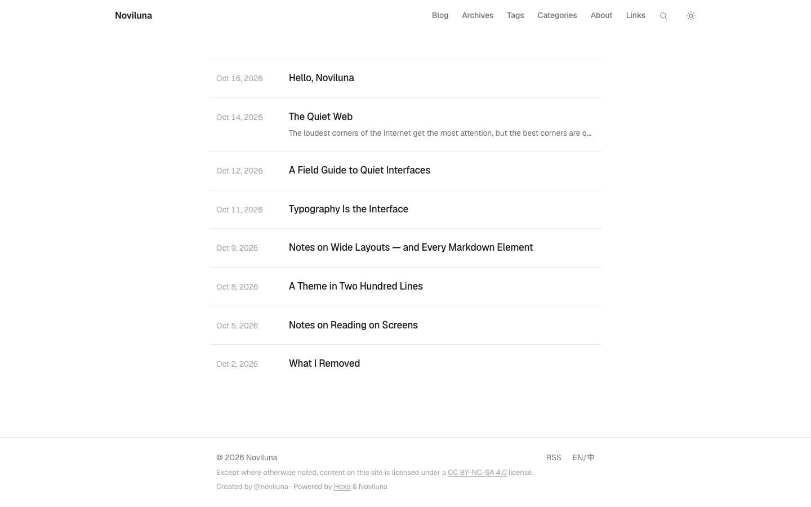
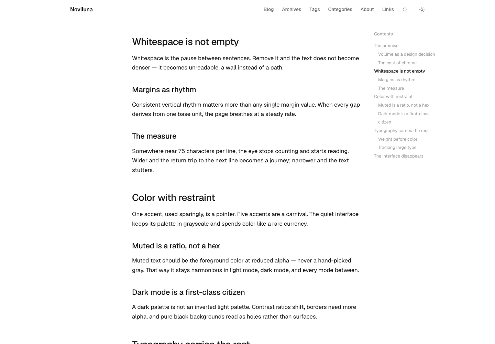
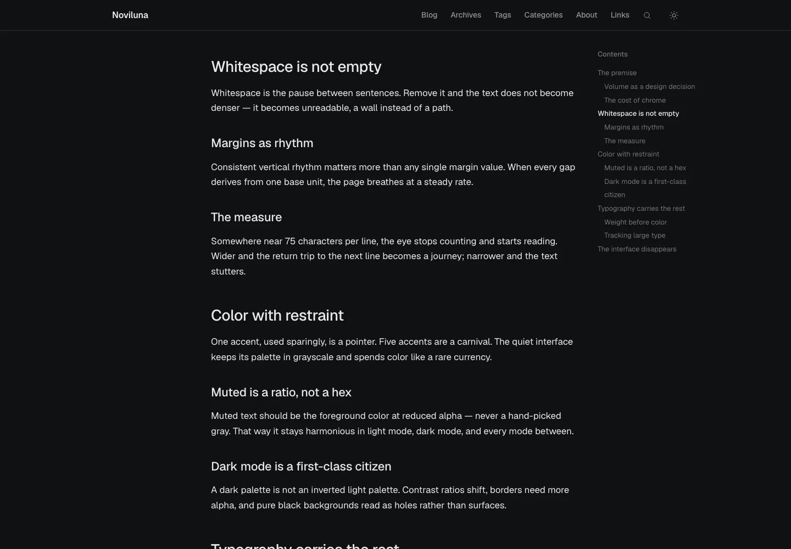

# Noviluna

> 一个安静的排版型 Hexo 主题 —— 一栏、细线,别无他物。

[English](README.md) · **简体中文**



Noviluna 只围绕一件事:让页面消失在文字背后。一栏居中、克制的字号层级、用细线代替卡片和阴影,任何不承载意义的装饰都不存在。

| 带目录的文章 | 暗色模式 |
| --- | --- |
|  |  |

## 特性

- **单栏排版** —— 720px 正文栏、流式标题、17px/1.625 正文
- **明暗双主题** —— token 驱动配色,跟随 `prefers-color-scheme`,无加载闪烁
- **目录索引** —— 右侧吸附栏 + 滚动高亮,≥1200px 显示
- **本地搜索** —— 全屏覆盖层,读取静态 `search.json`,全键盘操作
- **多语言** —— 内置英文与简体中文,外加客户端 UI 语言切换
- **排版优先** —— Geist / Geist Mono,中文使用 HarmonyOS Sans SC
- **代码高亮** —— 由主题 token 派生的低对比配色
- **分类 / 标签 / 归档** —— 细线索引页,带文章数
- **阅读信息** —— 字数、阅读时长、最后编辑时间
- **相关文章** —— 构建期同标签评分,无需插件
- **宽版式** —— 单篇 `wide: true`,适合表格和长代码
- **评论区** —— giscus,懒加载并与主题联动,默认关闭
- **友链页** —— 由数据文件驱动
- **可配置页脚** —— 许可协议、作者、驱动、ICP 备案,全部可选
- **零框架** —— 无 CSS/JS 依赖,约 170 行原生 JS

## 环境要求

- Hexo 5 或更新(基于 Hexo 8 开发)
- Node.js 18+

## 安装

### Git

```bash
cd your-blog
git clone https://github.com/dingyi222666/hexo-theme-noviluna.git themes/noviluna
```

### npm

```bash
cd your-blog
npm install hexo-theme-noviluna
```

然后在站点 `_config.yml` 中启用:

```yaml
theme: noviluna
```

> 使用 npm 安装时,Hexo 会从 `node_modules` 解析 `theme: noviluna`,请保持包名一致或将其软链到 `themes/`。

### 必需插件

Hexo 8 已不再内置首页、归档、标签、分类生成器,主题还需要搜索索引和订阅源。在站点中安装:

```bash
npm install hexo-generator-index hexo-generator-archive \
  hexo-generator-tag hexo-generator-category \
  hexo-generator-search hexo-generator-feed
```

并在**站点** `_config.yml` 中加上对应配置:

```yaml
# 必需 —— 首页 / 归档 / 标签 / 分类页
index_generator:
  path: ''
  per_page: 10

# 必需 —— 搜索覆盖层读取此索引
search:
  path: search.json
  field: post
  content: true

# 必需 —— 页脚 RSS 链接指向此处
feed:
  type: atom
  path: atom.xml
  limit: 20
  content: true

# 建议 —— 目录索引依赖标题 id
marked:
  gfm: true
  headerIds: true
```

## 配置

所有主题选项位于 `themes/noviluna/_config.yml`,全部可选。常用的几项:

| 配置项 | 默认值 | 说明 |
| --- | --- | --- |
| `accent` | `#2563EB` | 强调色,样式中通过 `var(--accent)` 使用 |
| `excerpt` | `true` | 首页每篇显示一行摘要 |
| `nav` | Blog / Archives / Tags / Categories / About / Links | 顶部导航 |
| `fonts.geist` | `true` | 加载 Geist + Geist Mono |
| `fonts.harmonyos` | `true` | 加载鸿蒙中文字体 |
| `meta.updated` | `true` | 显示"编辑于…" |
| `meta.wordcount` | `true` | 显示字数与阅读时长 |
| `meta.views` | `false` | 显示不蒜子浏览量 |
| `toc.enable` | `true` | 右侧目录索引 |
| `toc.max_depth` | `3` | 目录收录到几级标题(h2–h3) |
| `related_posts.enable` | `true` | 相关文章 |
| `related_posts.max` | `4` | 相关文章条数 |
| `comments.enable` | `false` | giscus 评论 |
| `busuanzi.enable` | `false` | 浏览量统计 |
| `search.enable` | `true` | 本地搜索覆盖层 |
| `footer.*` | — | 许可协议 / 作者 / 驱动 / 备案 |
| `language_switcher` | `true` | 页脚 EN/中 语言切换 |
| `links_intro` | — | 友链页说明文字 |

部分字段支持**纯字符串**或**按语言分别取值**:

```yaml
footer:
  author: "@yourname"
  # 或
  author:
    en: "@yourname"
    "zh-CN": "@你的名字"
  icp:
    en: ""                      # 英文站隐藏
    "zh-CN": "京ICP备00000000号"
```

## Front-matter

```yaml
---
title: 一篇文章
date: 2026-10-16
tags: [design, typography]
categories: [Notes]
wide: true        # 加宽到 980px(表格、长代码),同时隐藏目录
toc: false        # 本篇不显示目录
comments: false   # 本篇不显示评论
related: false    # 本篇不显示相关文章
---
```

## 额外页面

在站点 `source/` 下创建:

```markdown
<!-- source/tags/index.md -->
---
title: Tags
layout: tags
---
```

```markdown
<!-- source/categories/index.md -->
---
title: Categories
layout: categories
---
```

```markdown
<!-- source/links/index.md -->
---
title: Links
layout: page
links: true
---
```

友链内容来自 `source/_data/links.yml`:

```yaml
- name: Example Blog
  url: https://example.com
  desc: 关于设计与代码的安静写作。
```

## 多语言

界面文案位于 `themes/noviluna/languages/en.yml` 与 `zh-CN.yml`。在站点 `_config.yml` 中设置语言:

```yaml
language: zh-CN
```

页脚的语言开关可以在**不刷新**页面的情况下切换所有界面文案与日期格式,但**不会**翻译文章内容 —— 静态站点只有一种内容语言。设置 `language_switcher: false` 可隐藏该开关。

## 评论

giscus 已完整接线,但未配置前完全不产生任何 DOM。在开启了 Discussions 的公开仓库上安装 [giscus app](https://github.com/apps/giscus),然后填入 https://giscus.app 给出的参数:

```yaml
comments:
  enable: true
  giscus:
    repo: "yourname/yourrepo"
    repo_id: "R_kgDO…"
    category: "Announcements"
    category_id: "DIC_kwDO…"
```

## 开发

主题逻辑使用 TypeScript 编写,编译产物提交在 `scripts/`(构建期 helper)与 `source/js/`(浏览器端)。模板仍为 EJS —— Hexo 自己渲染 `themes/*/layout/*`,目前没有仍在维护的渲染器能把这条管线暴露给 JSX —— 因此 `.ejs` 只是调用类型化 helper 的薄壳。

```bash
npm install          # typescript、@types/node、js-yaml 类型
npm run build        # 编译 src/ts → scripts/,src/client → source/js
npm run watch        # 改动时增量编译(另开终端跑 hexo server)
```

源码结构:

```
src/ts/        构建期 helper  → scripts/*.js
src/client/    浏览器端代码    → source/js/*.js
layout/        EJS 模板
source/css/    noviluna.styl
languages/     en.yml、zh-CN.yml
```

修改 `src/` 下任何文件后,请执行 `npm run build`,并把源码与编译产物一起提交。

## 许可

[MIT](LICENSE)
